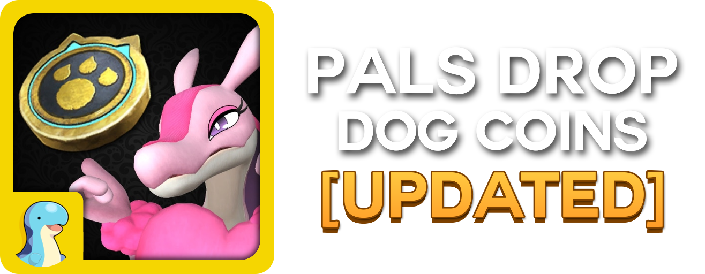

<p align="center">
  
</p>


<p align="center">
  This is a simple update to <a href=https://steamcommunity.com/sharedfiles/filedetails/?id=3626214974>KoZ's Pals Drop Dog Coins</a> Mod. Workshop ID `3626214974`.
</p>

<p align="center">
  All pals will now drop dog coins! Wild pals have a 20% chance to drop Dog Coins. Bosses have a 100% chance to drop them.
</p>

<p align="center">
  KoZ's original mod still works however, the mod was last updated in December 2025, before Palworld 1.0 launched in July 2026. All I've done was include the new Pals so the mod is a bit more up to date with the latest version.
</p>

<p align="center">
  I use this mod regularly, so I'll try to keep it updated as much as possible. If you come across any issues or bugs, please let me know so I can try to fix them.
</p>

<p align="center">
  If KoZ requests me to remove this mod, I will oblige by his wishes.
</p>

<p align="center">
  Available for Subscribing on the Steam Workshop: <a href=https://steamcommunity.com/sharedfiles/filedetails/?id=3816899969>Pals Drop Dog Coins</a>
</p>

<p align="center">
  Made with love for the community! Thank you to everyone who was
  welcoming and kind ♥️
</p>

## Requirements

- **PalSchema** 0.6.0 or newer.
- **UE4SS Experimental (Palworld)** — the Palworld-specific build.

Do **not** also install UE4SS by hand if the Steam Workshop version is present.

If you have KoZ's mod installed, **unsubscribe from it first.** This mod
includes his rows, so having both active means two mods writing the same
values.

## Install

Subscribe on Steam Workshop [Pals Drop Dog Coins [Palworld 1.0.5]](https://steamcommunity.com/sharedfiles/filedetails/?id=3816899969), then enable it in-game under
**Options → Mod Management**.

## What it contains

| File | Rows | Family | Drop rate |
|------|------|--------|-----------|
| `PalDrops.jsonc` | 314 | Normal Pals | 20% |
| `BossDrops.jsonc` | 290 | Alpha (`BOSS_*`) | 100% |
| `PredatorDrops.jsonc` | 40 | Predator (`PREDATOR_*`) | 100% |
| **Total** | **644** | | |

Each row writes DogCoin into drop **Slot 10**:

```jsonc
"WorldTreeDragon000": {
    "ItemId10": "DogCoin",
    "Rate10": 100.0,
    "min10": 1,
    "Max10": 3
}
```

Slot 10 was chosen deliberately. No patched row uses more than **3** of its 10
available slots, so nothing that already drops is overwritten.

**Any other mod that modifies Slot 10 for a Pal's Item Drops will likely cause issues, please be aware**

Rows added by this mod have a `// Display Name (InternalID)` comment so you
can identify any row without leaving the file.
